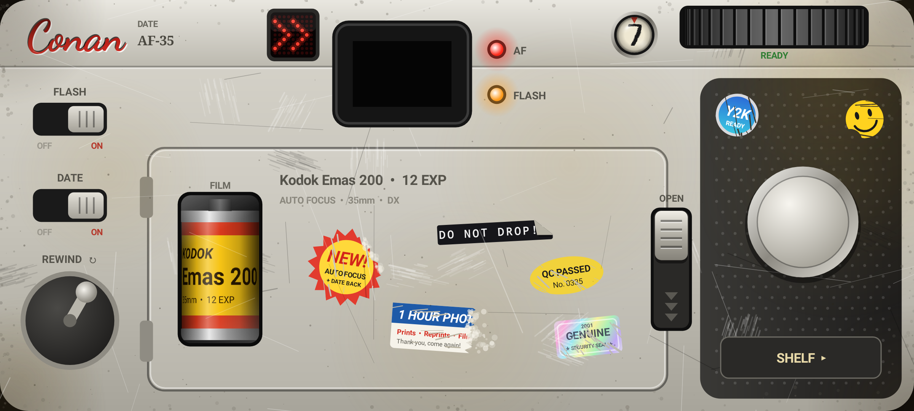
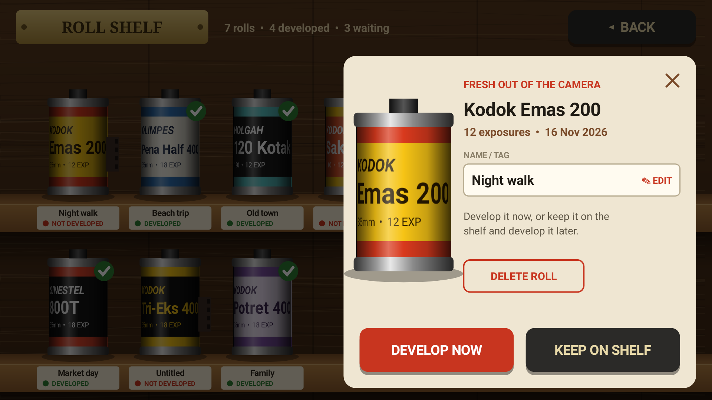

# Conan AF-35

A native Android app that simulates a cheap early-2000s point-and-shoot film camera.
You load a roll, wind before every shot, and commit to finishing it. The photos stay
hidden until you develop the roll.

| Camera back and roll shelf | Roll card |
|---|---|
|  |  |

## Features

- Tiny optical viewfinder only, no big preview. Autofocus with a red LED when in focus.
- Wind lever, shutter lock, flash toggle, date back, convex-glass frame counter.
- 12 or 18 frame rolls. Rewind and the back door stay locked until the roll is finished.
- 17 parody film stocks, including unusual formats (half frame, XPan-like pano, 6x17, 110, Holga).
- 3D roll shelf inside the camera back, plus a wooden shelf where you name, develop, view or delete rolls.
- Film look engine in pure Kotlin: tone curves, split toning, halation, grain, vignette, light leaks, barrel distortion.
- Red dot-matrix display for warnings (shutter locked, low film, steady, BW, low battery).
- Procedural sounds, no audio assets.

## Build

Requirements: JDK 17 and the Android SDK (platform 34).

```
echo "sdk.dir=/path/to/android/sdk" > local.properties
./gradlew assembleDebug
```

The APK is written to `app/build/outputs/apk/debug/`. Minimum Android 10 (API 29), landscape only.

Screenshot tests (Robolectric) render the views to `app/build/shots`:

```
./gradlew testDebugUnitTest
```

## Project layout

| File | Role |
|---|---|
| `Films.kt` | Film stock definitions and look parameters. Add a roll here. |
| `FilmLook.kt` | Development pipeline applied to raw frames. |
| `CameraBodyView.kt` | Camera body, controls, stickers and wear. |
| `BackDoorView.kt` | Open back door with the 3D roll chooser. |
| `ShelfView.kt` | Wooden shelf of exposed rolls. |
| `Canister.kt` | Pseudo-3D film canister rendering. |
| `DotMatrix.kt` | 9x9 red dot-matrix display. |
| `Sfx.kt` | Generated sound effects. |
| `Lab.kt`, `Rolls.kt`, `CamState.kt` | Development, roll storage, persisted camera state. |

## Ideas for contributors

- Real panorama stitching instead of cropping.
- Free combination of format and film stock.
- Light meter and manual exposure quirks.
- Localization (the UI is English only).
- On-device testing: shutter detection, battery polling, flash and haptics are untested on real hardware.
- So far, no major bugs, but this app requires A LOT of polish

## Notes

- Film names are parodies. This project is not affiliated with any camera or film maker.
- "Conan" and the stickers are original artwork drawn in code.

## License

GPL-3.0, see `LICENSE`.
